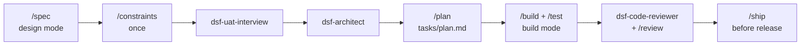

# dsf-addy-osmani workflow

This factory uses [agent-skills](https://github.com/addyosmani/agent-skills) by Addy Osmani: production-grade engineering skills that cover the whole lifecycle (define, plan, build, verify, review, ship) as slash commands, plus specialist reviewer personas for security, tests and performance.

## How a feature flows

1. `make design`, then `/spec` with your vision; the spec goes to `specs/prd.md`.
2. `/constraints` once: the app's quality bar in `CONSTRAINTS.md`.
3. UAT interview and architecture (`dsf-uat-interview`, `dsf-architect`).
4. `/plan` writes `tasks/plan.md` and `tasks/todo.md`; approve the plan once.
5. `make build`, then `/build`: it implements task by task, test-first, committing each one.
6. `dsf-code-reviewer`, then `/review` for the five-axis review; `/ship` before a release.

Full step-to-skill mapping: [.dsf/CLAUDE.workflow.md](../../.dsf/CLAUDE.workflow.md).

## Strengths and weaknesses

| Strengths | Weaknesses |
| --- | --- |
| The widest lifecycle coverage, including security, performance, CI/CD and launch. | Its own file conventions (`SPEC.md`, `tasks/plan.md`) need mapping to the factory's. |
| Explicit commands make each step visible and easy to audit. | Less strict about TDD than Superpowers. |
| Specialist personas (security auditor, test engineer, performance auditor) add review depth. | Many skills: the agent has to be pointed at the right one. |

## Installing and upgrading

Claude Code offers to install the plugin the first time it starts in the repo (from `.dsf/settings/workflow.json`). Upgrade with `/plugin` → Marketplaces → update, then run the factory benchmark ([docs/dsf/factory-evolution.md](../dsf/factory-evolution.md#benchmark)).
